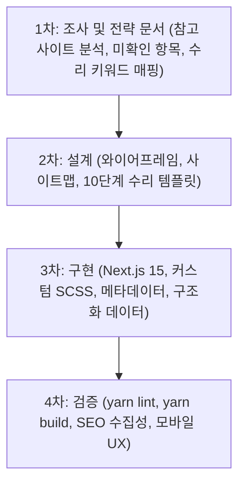

# 프로젝트: 부산·김해·창원 지역 특화형 샷시·창문 수리 전문 홈페이지 구축 및 로컬 SEO 전략

> 본 문서는 **조은샷시** 프로젝트의 비즈니스 목표, 고객 분석, 지역 SEO 전략, 사이트맵 및 단계별 산출물 기준을 정의한 프로젝트 실행 명세서입니다.
> 모든 작업은 [AGENTS.md](AGENTS.md)의 기술 및 아키텍처 규약을 준수하며 진행합니다.

---

## 1. 프로젝트 개요 및 핵심 목표

- **상호명**: **조은샷시** (영문명 표기 불필요)
- **업종**: **샷시·창문·방충망 수리 및 보수 전문** (비싼 전체 교체 대신 수리로 90% 비용 절감)
- **주력 서비스**:
  1. **창문 롤러(바퀴) 교체 및 수평 조정**: 뻑뻑하거나 꿈쩍도 않는 무거운 창문, 바닥 긁힘 수리
  2. **깨진 샷시 레일 스테인리스 보강**: 플라스틱 레일 파손 및 깨짐을 영구적인 고강도 스텐 레일로 덧씌움 보강
  3. **외풍·먼지 차단 모헤어(방풍털) 전면 교체**: 10년 이상 삭아서 가루 날리고 바람 새는 모헤어 교체로 단열·기밀성 복원
  4. **친환경 미세방충망 교체 & 망갈이**: 찢어지고 삭은 알루미늄망 대신 부식 없는 고강도 미세방충망 시공
  5. **창문 잠금장치(크리센트/자동손잡이) 수리 및 교체**: 안 닫히고 헛도는 락 장치 규격품 교체
- **타깃 권역**: **부산광역시 · 경상남도 김해시 · 경상남도 창원시** (세부 데이터: `src/data/regions.json`)
- **주요 고객**: 부산·김해·창원 전 지역 아파트, 빌라, 단독주택, 상가에서 창문 노후화 및 고장으로 불편을 겪는 고객
- **주요 검색엔진**: 네이버 (SmartPlace, 플레이스/웹 검색), 구글 (Search, Local, AI Overviews)
- **개발 환경**: Next.js 15+ (App Router), React 19, TypeScript 5, SCSS (Dembrandt 토큰 기반 커스텀 디자인 시스템)
- **참고 사이트**: [https://gaya-door.hsweb.pics/](https://gaya-door.hsweb.pics/)
- **1차 전략 보고서**: [docs/STRATEGY_REPORT.md](docs/STRATEGY_REPORT.md)
- **최종 목표**:
  단순히 보기 좋은 홈페이지가 아니라, **지역 고객의 수리 검색 유입을 선점하고, 실제 전화 상담(`tel:`) 및 무료 출장 견적 요청으로 전환시키는 실전 비즈니스 홈페이지 구축**.

---

## 2. 미확인 정보 관리 원칙 (Strict Truth First)

아직 확정되지 않은 업체 정보는 **절대로 임의로 지어내지 않고 `[확인 필요]`로 명시**합니다.

### 사전 확보 및 사용자 확인 필요 항목 체크리스트:
- [x] 상호명: **조은샷시** (확정)
- [x] 타깃 권역: **부산광역시, 김해시, 창원시** (확정)
- [x] 핵심 업종: **샷시·창문 수리 및 부품 보수 전문** (확정)
- [ ] 실제 사업장 주소 및 사업자 등록 정보 (`[확인 필요]`)
- [ ] 대표 전화번호 및 상담 가능 시간 (`010-0000-0000 [확인 필요]`)
- [ ] 실제 시공 사례 및 고화질 현장 사진 (`[확인 필요]`)
- [ ] 부위별 정확한 수리 비용 체계 및 무상 A/S 기간 (`[확인 필요]`)
- [ ] 기존 도메인 및 네이버 스마트플레이스 등록 여부 (`[확인 필요]`)

---

## 3. 7단계 실행 프로토콜 및 산출물 기준

### 1단계: 참고 사이트 분석
참고 사이트([https://gaya-door.hsweb.pics/](https://gaya-door.hsweb.pics/))를 직접 조사하여 구조와 강점을 벤치마킹합니다.

**확인 항목**:
1. 전체 페이지 구조와 메뉴 네비게이션
2. 메인 페이지의 콘텐츠 블록 구성
3. 수리 서비스 소개 방식 (고장 증상 중심 분류)
4. 수리 사례와 이미지 전후(Before/After) 구성
5. 전화 연결 및 견적 상담 전환(CTA) 구조
6. 모바일 UX 및 로딩 성능
7. 페이지별 Title, Meta Description, URL 구조
8. 지역 키워드 노출 및 배치 방식
9. 내부 링크 및 페이지 간 연결 흐름
10. 개선점과 벤치마킹 요소

---

### 2단계: 지역 및 키워드 전략 수립
지역 타깃 키워드를 다음 조합으로 분석합니다:

- `[지역명] + 샷시 수리` / `[지역명] + 창문 수리`
- `[지역명] + 창문 롤러 교체` / `[지역명] + 샷시 레일 수리`
- `[지역명] + 외풍차단 모헤어` / `[지역명] + 미세방충망 교체`
- `[지역명] + 창문 바닥 긁힘` / `[지역명] + 뻑뻑한 샷시`
- `[지역명] + 샷시 수리 비용` / `[지역명] + 아파트 창문 틈새바람`
- `[동네명] + [실제 수리 아파트 단지명]` (예: 상남동 아파트 샷시 롤러 수리, 화명동 모헤어 교체)

**키워드 운영 원칙**:
1. 실제로 출장/수리 가능한 지역(부산, 김해, 창원)만 타깃팅합니다.
2. 비싼 전체 교체보다 **"수리로 비용 90% 절감"**이라는 고객 가치를 전면에 배치합니다.
3. 검색량 크기보다 **실제 전화 문의로 이어질 문제 해결형/구매 의도형 키워드**를 최우선 평가합니다.
4. 지역명만 바꾼 저품질 중복 페이지(Doorway Page) 생성을 엄격히 배제하고, 지역별 건축 연한(구축/신축) 및 환경(바닷바람, 산단 등) 특화 가치를 담습니다.

---

### 3단계: 홈페이지 정보 구조 설계 (Route-First Site Structure)
다이얼로그(모달) 남용을 배제하고, 검색엔진 크롤링 및 URL 공유가 가능한 고유 경로(Route-First)로 설계합니다.

**페이지 유형**:
- 메인 홈페이지 (`/`)
- 창문·샷시 수리 (`/services/window-repair`): 롤러 교체, 레일 보강, 모헤어 교체 통합 안내
- 미세방충망 교체 (`/services/screen-window`)
- 수리 비용 가이드 (`/pricing`): 부위별 예상 수리 비용 및 무료 출장 견적 안내
- 수리 사례 모음 (`/projects`)
- 수리 사례 상세 (`/projects/[slug]`)
- 지역별 출장 수리 안내 (`/areas/[region]`): 부산(`/areas/busan`), 김해(`/areas/gimhae`), 창원(`/areas/changwon`)
- 자주 묻는 질문 (`/faq`)
- 업체 소개 및 시공 원칙 (`/about`)
- 견적 문의 및 출장 요청 (`/contact`)

---

### 4단계: 실제 전환을 위한 콘텐츠 설계
고객의 불안과 의문을 해소하고 신뢰를 구축하는 콘텐츠를 배치합니다:
- **전체 교체 vs 부분 수리 비용 비교** (수백만원 교체 견적을 10~20만원대 수리로 해결)
- **우리 집 창문 고장 자가진단 4대 증상** (뻑뻑함/안 열림, 레일 깨짐, 외풍/털가루 날림, 방충망 찢어짐)
- **조은샷시만의 4대 특화 기술** (KS 규격 롤러, 고강도 스테인리스 레일 보강, 친환경 고밀도 모헤어, 모노필라멘트 미세망)
- **당일 출장 4단계 수리 공정** (문의 접수 → 현장 점검 → 당일 수리 → 개폐 테스트 및 품질 보증)
- **수리 후 무상 A/S 보증 기준**

**10단계 수리 사례(Case Study) 템플릿**:
1. 수리 지역 및 주거 유형 (예: 창원시 성산구 상남동 OO아파트 32평형)
2. 고객이 겪었던 기존 문제점 (창문이 꿈쩍도 안 하고 레일이 깨짐)
3. 현장 실측 및 고장 원인 진단 (노후 플라스틱 롤러 파손 및 하부 레일 침식)
4. 수리 솔루션 (맞춤형 트윈 롤러 교체 + 스텐 레일 덧씌움 보강)
5. 창틀 안전 탈거 및 수리 공정
6. 수리 전후(Before / After) 비교 사진
7. 부드러운 개폐감 및 수평 맞춤 결과
8. 합리적인 수리 비용 명세
9. 샷시 오래 쓰는 관리 팁
10. 해당 지역 유사 증상 즉시 전화/간이견적 CTA

---

### 5단계: 네이버·구글 SEO 및 AI 검색(AEO/GEO) 대응

#### 1) 기술적 SEO (Technical SEO)
- 페이지별 고유한 `title` 및 `description` (`generateMetadata`)
- 시맨틱 마크업 (`h1`~`h3`, `header`, `nav`, `main`, `article`, `section`, `footer`)
- `canonical` URL, `robots.txt`, `sitemap.xml` 자동 생성
- 모든 이미지 최적화 및 명확한 한국어 `alt` 태그
- Core Web Vitals (LCP, CLS, INP) 최적화 (Next.js 15 SSR 듀얼 파일 패턴 기반)

#### 2) 지역 비즈니스 정보 (Local SEO)
- 업체명(**조은샷시**), 대표번호, 출장 지역(부산·김해·창원)의 일관성 유지
- Schema.org 구조화 데이터 적용 (`HomeAndConstructionBusiness`, `LocalBusiness`, `FAQPage`, `BreadcrumbList`)
- 네이버 스마트플레이스 및 구글 비즈니스 프로필과의 일치 설계

#### 3) AI 검색 엔진 최적화 (AEO / GEO)
- 질문(외풍 원인, 샷시 롤러 수명 등)과 명확한 해결책 중심의 Fact 기반 Q&A 구조화
- 출장 가능 지역(부산, 김해, 창원)과 불가능 지역의 명확한 경계 제시
- 수리 공정과 부품 자재의 투명한 정보 제공

---

### 6단계: Next.js 15+ 및 커스텀 디자인 시스템 구현 원칙
- **Next.js 15 App Router + React 19 + TypeScript 5**: 최신 표준 기술 스택 준수.
- **SSR / CSR 듀얼 파일 패턴**: 인덱싱 대상 공개 페이지는 `page.tsx`(Server) + `*Client.tsx`(Client)로 엄격히 분리.
- **외부 거대 UI 라이브러리 배제**: MUI, Tailwind 등을 사용하지 않고, Dembrandt 토큰 기반 커스텀 UI(`src/components/ui/*`) 및 컴팩트 BEM SCSS로 구현.
- **모바일 최적화**: 전화 연결(`tel:`) 및 30초 견적 바를 모바일 하단에 플로팅 배치(`FloatingCtaBar`). `@include hover`로 터치 기기 호버 잔류 방지.

---

### 7단계: 작업 순서 및 4단계 산출물 로드맵

