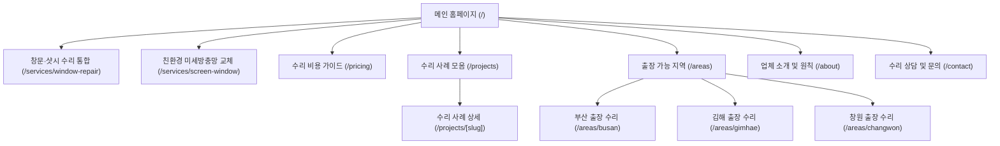

# [1차 산출물] 부산·김해·창원 샷시·창문 수리 전문 홈페이지 조사 및 로컬 SEO 전략 보고서

> **작성일**: 2026-10-28  
> **프로젝트**: 조은샷시  
> **타깃 권역**: 부산광역시 · 김해시 · 창원시  
> **참조 사이트**: [https://gaya-door.hsweb.pics/](https://gaya-door.hsweb.pics/)  

---

## 1. 참고 사이트 (가야도어) 실측 정밀 분석 보고서

참고 사이트 `https://gaya-door.hsweb.pics/`를 직접 분석하여 샷시·창문 수리 업종에 적합하게 벤치마킹한 결과입니다.

### 1.1. 참고 사이트 10대 항목 분석표

| 분석 항목 | 현재 확인된 상태 (가야도어) | 개선 및 차별화 방향 (조은샷시) | 우선순위 |
| :--- | :--- | :--- | :--- |
| **1. 전체 페이지 구조** | 메인 단일 페이지 중심 + 일부 블로그 포스트 상세(`/posts/[id]`) | **Route-First 고유 URL 체계**: 수리 서비스별(`/services/*`), 지역별(`/areas/*`), 수리사례(`/projects/*`) 개별 페이지 분리 | **High** |
| **2. 메인 페이지 구성** | 히어로 배너 슬라이드 → 신뢰 띠 배너 → 지역 검색 패널 → 고장 증상 그리드 → 4단계 프로세스 → 전후(Before/After) 갤러리 | 가야도어의 직관적인 흐름을 계승하되, **'교체 대비 수리로 90% 비용 절감' 및 '30초 증상별 간이견적 폼' 탑재** | **High** |
| **3. 수리 서비스 소개 방식** | 문수리 중심(강화도어, 방화문, 자동문) 3대 분류 및 체크리스트 | 샷시·창문 수리 중심(**롤러 교체 & 수평 조정, 깨진 레일 스텐 보강, 외풍 차단 모헤어 교체, 친환경 미세방충망**)으로 재편 | **High** |
| **4. 수리 사례와 이미지 구성** | 2열 그리드로 정적 시공 전/후 사진 제시 + 네이버 블로그 링크 | 정적 이미지를 넘어 **인터랙티브 Before/After 슬라이더** 및 **10단계 수리 스토리 템플릿** 적용 | **High** |
| **5. 전화 및 상담 전환 구조** | 상단/히어로의 전화 링크 및 네이버 블로그 링크 | 모바일 화면 하단에 항상 고정되는 **`FloatingCtaBar`(전화 바로걸기 + 30초 간이견적)** 구축 | **High** |
| **6. 모바일 UX 및 로딩 성능** | Next.js App Router 기반 WebP 이미지 최적화, 반응형 깔끔함 | Next.js 15+ & React 19 기반 SSR/CSR 분리 및 `@include hover` 터치 간섭 방지로 LCP/CLS 극대화 | **Mid** |
| **7. SEO 메타 및 URL 구조** | `title`, `description`, `canonical`, 네이버/구글 서치콘솔 메타 완비 | 페이지별 고유 `generateMetadata`, OpenGraph, 지역/구 단위 맞춤형 타이틀 설계 | **High** |
| **8. 지역 키워드 사용 방식** | 드롭다운 셀렉트 폼으로 부산/김해/양산/창원의 구/동 선택 제공 | 드롭다운뿐만 아니라, **각 구/동별 고유 URL(`/areas/busan`, `/areas/gimhae`, `/areas/changwon`)을 생성하여 검색엔진 색인화** | **High** |
| **9. 내부 링크 및 연결 흐름** | 네이버 블로그 외부 링크 의존도가 다소 높음 | 사이트 내부 수리 사례와 견적 페이지 간 유기적인 내부 링크(Internal Linking) 강화 | **Mid** |
| **10. 구조화 데이터 (Schema)** | `HomeAndConstructionBusiness`, `FAQPage` JSON-LD 탑재 확인 | `HomeAndConstructionBusiness`, `LocalBusiness` 세부 속성(수리 서비스, 출장 지역) 및 브레드크럼 확장 | **Mid** |

---

## 2. 업체 정보 미확인 항목 질의서 (Strict Truth First)

허위 정보 및 조작 방지를 위해 실제 수리 및 사이트 런칭 전에 사용자에게 확인해야 할 핵심 항목입니다.

| 구분 | 확인 항목 | 현재 상태 | 필요 이유 / 반영 위치 |
| :--- | :--- | :--- | :--- |
| **기본 정보** | 공식 상호명 | **조은샷시** (확정) | 푸터 사업자 정보, Schema.org 구조화 데이터 |
| **타깃 권역** | 주력 출장 가능 지역 | **부산광역시, 김해시, 창원시** (확정) | 헤더/푸터, 지역별 안내 페이지, 메타데이터 |
| **핵심 업종** | 주력 서비스 범위 | **샷시·창문 수리 및 보수 전문** (확정) | 서비스 소개, 자가진단 그리드, 검색 키워드 |
| **사업장 위치** | 실제 매장/사무실 주소 | `[확인 필요]` | 네이버 스마트플레이스, 구글 지도 매핑, 출장 기준지 |
| **연락처** | 대표 상담 전화번호 | `010-0000-0000 [확인 필요]` | 모든 `tel:` 버튼 및 모바일 플로팅 CTA |
| **상담 시간** | 상담 가능 시간 및 주말 출장 여부 | `평일 08:00~19:00 / 토 09:00~16:00 (가안)` `[확인 필요]` | 헤더 안내 문구 및 FAQ |
| **수리 비용** | 부위별(롤러, 레일, 모헤어, 방충망) 시작 가격대 | `[확인 필요]` | 견적 안내 페이지의 신뢰성 확보 (불확실 시 '무료 사진 상담') |
| **A/S 및 보증** | 수리 후 무상 A/S 기간 및 품질 보증 기준 | `[확인 필요]` | 1년 무상 A/S 등 신뢰 뱃지 표기 |
| **현장 사진** | 보유 중인 실제 수리 전후 사진 유무 | `[확인 필요]` | 수리 사례 페이지 및 갤러리 (없을 시 촬영 가이드 제공) |

---

## 3. 부산·김해·창원 권역별 키워드 전략 및 검색 의도 분류

### 3.1. 4대 검색 의도(Intent)별 타깃 키워드

1. **지역 탐색형 (Local Navigational)**:
   - `부산 샷시 수리`, `김해 창문 수리 업체`, `창원 샷시 롤러 교체`, `장유 창문 수리`, `해운대 샷시 수리`
2. **문제 해결형 (Problem Solving / Informational)**:
   - `뻑뻑한 창문 안 열릴 때`, `베란다 창문 틈새 바람`, `샷시 레일 깨짐 보강`, `창문 바닥 긁힘`, `삭은 모헤어 털가루 날림`
3. **구매 의도형 (Commercial / Transactional)**:
   - `부산 샷시 롤러 교체 비용`, `김해 샷시 레일 수리 견적`, `창원 아파트 모헤어 교체 가격`, `부산 미세방충망 당일 교체`
4. **비교 및 가치 입증형 (Comparative / Value)**:
   - `샷시 교체 vs 수리 비용 비교`, `창문 롤러 규격품 교체`, `스테인리스 레일 보강 내구성`

---

### 3.2. 권역별 핵심 타깃 키워드 매핑 테이블

| 권역 | 타깃 키워드 | 검색 의도 | 연결 페이지 URL | 콘텐츠 집중 방향 | 우선순위 |
| :--- | :--- | :--- | :--- | :--- | :--- |
| **부산** | `부산 샷시 수리` | 지역 탐색 / 문제 해결 | `/areas/busan` | 부산 전지역 당일 출장, 뻑뻑한 창문·깨진 레일 수리 | **High** |
| 부산 | `해운대 아파트 샷시 수리` | 지역 탐색 / 고단가 | `/areas/busan` | 해운대 신도시 구축 해풍 염분 부식 롤러 교체, 외풍 차단 | **High** |
| 부산 | `부산 창문 외풍 차단 모헤어` | 문제 해결형 | `/services/window-repair` | 삭은 모헤어 전면 교체, 틈새 바람 및 털가루 완벽 차단 | **High** |
| 부산 | `화명동 창문 롤러 교체` | 지역 탐색형 | `/areas/busan` | 화명신도시 20년차 대단지 베란다 대형창 롤러 수리 | **High** |
| 부산 | `부산 미세방충망 망갈이` | 생활 밀착 / 구매 | `/services/screen-window` | 찢어진 알루미늄망 대신 부식 없는 친환경 미세망 시공 | **Mid** |
| **김해** | `김해 샷시 수리` | 지역 탐색 / 문제 해결 | `/areas/gimhae` | 김해 전지역 당일 출장 수리, 합리적 출장 견적 | **High** |
| 김해 | `장유 샷시 롤러 교체 비용` | 구매 의도 / 가격 | `/areas/gimhae` | 장유 1기 신도시 아파트 창문 롤러 교체 및 레일 보강 | **High** |
| 김해 | `내외동 아파트 샷시 수리` | 지역 / 노후 해결 | `/areas/gimhae` | 30년차 내외동 대단지 뻑뻑한 창문 복원, 수평 맞춤 | **High** |
| 김해 | `율하 미세방충망 교체` | 구매 의도형 | `/services/screen-window` | 율하 1·2지구 아파트 및 주택 친환경 미세방충망 | **Mid** |
| **창원** | `창원 샷시 수리` | 지역 탐색 / 문제 해결 | `/areas/changwon` | 창원 전지역 성산·의창·마산·진해 맞춤 당일 출장 | **High** |
| 창원 | `창원 성산구 창문 수리` | 지역 / 문제 해결 | `/areas/changwon` | 상남/반송/대방 30년차 구축 아파트 레일 깨짐 스텐 보강 | **High** |
| 창원 | `마산 베란다 창문 롤러 교체` | 지역 탐색형 | `/areas/changwon` | 마산합포/회원구 아파트 바닷바람 소음 및 롤러 교체 | **High** |
| 창원 | `창원 샷시 수리 비용` | 구매 의도형 | `/pricing` | 부위별(롤러, 레일, 모헤어, 방충망) 합리적 수리 단가표 | **High** |

---

## 4. Route-First 홈페이지 사이트맵 및 페이지별 명세

크롤러 색인과 URL 공유가 불가능한 모달을 배제하고, 고유 URL을 갖는 페이지 구조로 설계합니다.

### 4.1. 주요 페이지별 세부 기획 명세

#### 1) 메인 홈페이지 (`/`)
- **타깃 고객**: 부산·김해·창원에서 샷시 및 창문 고장으로 불편을 겪는 모든 주거 고객
- **SEO Title**: 조은샷시 | 부산·김해·창원 샷시·창문 수리 전문
- **Meta Description**: 부산, 김해, 창원 전지역 아파트·빌라 샷시 수리, 창문 롤러 교체, 레일 파손 보강, 모헤어 외풍 차단, 미세방충망 당일 출장 수리 전문.
- **H1**: 부산·김해·창원 샷시·창문 수리 전문 조은샷시
- **H2 계층**: 
  - H2-1: 우리 집 창문 수리가 시급한 4가지 증상 자가진단
  - H2-2: 전문 수리 서비스 안내 (롤러 교체, 레일 보강, 모헤어 외풍 차단, 미세방충망)
  - H2-3: 지역별 출장 수리 안내 (부산 · 김해 · 창원)
  - H2-4: 4단계 당일 출장 수리 공정
  - H2-5: 실제 수리 전후 비교 (Before / After)
  - H2-6: 실시간 30초 간이 견적 문의 및 당일 출장 신청
  - H2-7: 자주 묻는 질문 (수리 FAQ)

#### 2) 수리 서비스 상세 페이지 (`/services/window-repair`)
- **주요 내용**: 롤러 교체, 레일 보강, 모헤어 교체 원리와 시공 전후 비교, 부품 규격 안내
- **공통 블록**: 고장 원인 진단 → 정밀 수리 공정 → 전후 사진 → 비용 절감 효과 → 즉시 상담 CTA

#### 3) 지역별 특화 페이지 (`/areas/[region]`)
- **URL 구성**: `/areas/busan`, `/areas/gimhae`, `/areas/changwon` (하위 구/동 앵커 지원)
- **지역 특화 요소**: 지역별 아파트 단지 특성(구축 대단지, 바닷바람 염분 부식, 산단 환경 등)에 맞춘 맞춤형 솔루션 제공
